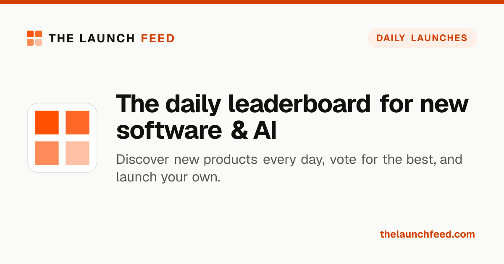
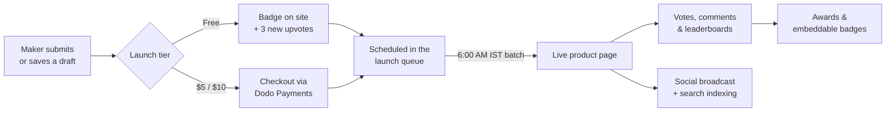
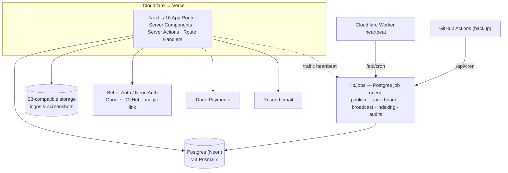

<div align="center">

<a href="https://thelaunchfeed.com">
  
</a>

<h3>Ship. Vote. Rise.</h3>

<p>
  The daily launchpad where makers ship software and AI products,<br />
  the community votes, and the best launches rise through the leaderboards.
</p>

<p>
  <a href="https://thelaunchfeed.com"></a>
  
  
  
  
  
  
</p>

<p>
  <a href="https://thelaunchfeed.com">Website</a> ·
  <a href="https://thelaunchfeed.com/submit">Launch a product</a> ·
  <a href="https://thelaunchfeed.com/leaderboard/weekly">Leaderboards</a> ·
  <a href="https://thelaunchfeed.com/founders">Founders</a> ·
  <a href="https://x.com/thelaunchfeed">X / Twitter</a>
</p>

</div>

---

## Contents

- [What it is](#what-it-is)
- [Features](#features)
- [How a launch works](#how-a-launch-works)
- [Architecture](#architecture)
- [Tech stack](#tech-stack)
- [Getting started](#getting-started)
- [Scripts](#scripts)
- [Project structure](#project-structure)
- [SEO & GEO](#seo--geo)
- [Deployment](#deployment)

## What it is

**The Launch Feed** is a product-launch platform for indie makers. Every day at **6:00 AM IST (00:30 UTC)** a new batch of software, SaaS and AI products goes live. The community upvotes, comments and saves, and products climb the **daily, weekly, monthly, yearly and all-time** leaderboards. Winners earn embeddable badges, and every listing links back to the maker's site.

## Features

| | |
|---|---|
| 🚀 **Launch queue** | Submit a product, pick a slot, and it publishes automatically at the next daily batch. Drafts, edits and resubmission after rejection are built in. |
| 🆓 **Free or paid launches** | Free launches need the Launch Feed badge on your site plus upvotes on 3 new launches. $5 / $10 launches skip that and add a 30-day Featured / Spotlight placement. |
| 🏆 **Leaderboards & awards** | Daily, weekly, monthly, yearly and all-time boards, with award badges for top finishers. |
| 🏅 **Embeddable badges** | SVG "Featured on" and award badges with a smart link that resolves to the product page once it is live. |
| 👤 **Founder profiles** | Public maker pages with products, upvotes and social links, plus a private dashboard for drafts, placements and settings. |
| 💸 **Verified revenue** | Optional MRR verification through Stripe, Paddle, Lemon Squeezy, Polar, Gumroad or RevenueCat. Provider keys are encrypted at rest. |
| ✨ **AI autofill** | Paste a website or GitHub URL and the submit form drafts the listing (tagline, features, pricing, FAQ…). |
| 📣 **Social broadcast** | New launches are posted automatically to X, Telegram, WhatsApp and Bluesky. |
| 🔎 **Search indexing** | New and updated pages are pushed to the Google Indexing API and IndexNow. |
| 🧭 **Directory outreach** | Crawls other launch directories for founder leads and sends launch invitations. |
| 🛠️ **Admin dashboard** | Review queue with full submission preview, users, moderation, featured slots, categories, revenue, emails and job automation. |

## How a launch works



## Architecture



Background work runs on a **self-hosted Postgres job queue** (`lib/jobs`) rather than a third-party service. A Cloudflare Worker (`workers/scheduler-heartbeat`) pings `/api/cron` every minute, with GitHub Actions and visitor traffic as fallbacks.

## Tech stack

| Layer | Tools |
|---|---|
| Framework | [Next.js 16](https://nextjs.org) (App Router, Turbopack), React 19, TypeScript |
| Styling | Tailwind CSS 4, Geist Sans / Mono, Doto |
| Data | PostgreSQL on [Neon](https://neon.tech), [Prisma 7](https://www.prisma.io) |
| Auth | [Better Auth](https://www.better-auth.com) via Neon Auth (Google, GitHub, magic link) |
| Payments | [Dodo Payments](https://dodopayments.com) |
| Email | [Resend](https://resend.com) |
| Images | S3-compatible object storage, AVIF uploads, `next/og` + sharp for social cards |
| AI | OpenAI (listing autofill) |
| Hosting | Vercel behind Cloudflare |

## Getting started

### Prerequisites

- Node.js 20.9+
- A PostgreSQL database (a free [Neon](https://neon.tech) project works)

### Setup

```bash
git clone https://github.com/mhqsoftech/thelaunchfeed.com.git
cd thelaunchfeed.com
npm install
cp .env.example .env.local
```

Fill in `.env.local`. Every variable is documented in [`.env.example`](.env.example); the essentials are:

| Variable | Purpose |
|---|---|
| `DATABASE_URL` | Postgres connection string |
| `NEXT_PUBLIC_APP_URL` | Public site URL, e.g. `http://localhost:3000` |
| `APP_SECRET` | Session signing secret (`openssl rand -hex 32`) |
| `TOKEN_ENCRYPTION_KEY` | Encrypts stored revenue-provider keys (`openssl rand -base64 32`) |
| `ADMIN_EMAIL` | The account that gets access to `/admin` |

Payments, email, storage, AI, social and indexing keys are optional for local development; their features stay off until configured.

Create the schema and (optionally) load demo data:

```bash
npm run db:push    # apply prisma/schema.prisma to the database
npm run db:seed    # optional demo products, makers and categories
npm run dev        # http://localhost:3000
```

> [!NOTE]
> The schema is applied with `db:push`, not `prisma migrate`. Run it again after changing `prisma/schema.prisma`.

> [!TIP]
> Scheduled jobs (publishing due launches, leaderboards, badge audits…) don't run during `npm run dev` unless you set `JOBS_INPROCESS=true`.

## Scripts

| Command | What it does |
|---|---|
| `npm run dev` | Start the dev server (Turbopack) |
| `npm run build` | Generate the Prisma client and build for production |
| `npm run start` | Serve the production build |
| `npm run lint` | Run ESLint |
| `npm run db:push` | Sync `prisma/schema.prisma` to the database |
| `npm run db:seed` | Load demo data |
| `npm run db:studio` | Open Prisma Studio |

## Project structure

```text
app/                    Routes (App Router)
├── page.tsx            Home feed
├── product/[slug]/     Product pages + generated social card
├── founder/[slug]/     Founder profiles + generated social card
├── leaderboard/        Weekly / monthly / yearly / all-time boards
├── submit/             Launch form (AI autofill, free-launch gate, checkout)
├── profile/            Maker dashboard
├── admin/              Admin dashboard
├── api/                Route handlers (cron, checkout, webhooks, badges…)
├── actions/            Server actions
├── sitemap.ts, robots.ts, llms.txt/, llms-full.txt/, feed.xml/
components/             Shared UI (home, submit, profile, ui)
lib/
├── jobs/               Postgres job queue and scheduled handlers
├── publish.ts          Turns a scheduled submission into a live product
├── free-launch.ts      Badge + upvote requirements for free launches
├── revenue/            Revenue-provider integrations
├── indexing/           Google Indexing API & IndexNow
├── og/                 Shared social-card renderer
├── seo/                JSON-LD helpers
└── email/              Email templates
prisma/                 Schema and seed
workers/                Cloudflare Worker for the scheduler heartbeat
```

## SEO & GEO

Every public page is built to be understood by search engines **and** AI answer engines:

- **Metadata** — unique titles, descriptions and canonical URLs; private routes (`/admin`, `/profile`, `/login`) are `noindex`.
- **Social cards** — every public page gets a generated 1200×630 PNG (`opengraph-image`). Product and founder cards show the logo or avatar, tagline and upvotes; AVIF / WebP uploads are converted to PNG so every network renders them.
- **Structured data** — JSON-LD `@graph` per page: `Organization` and `WebSite` site-wide, plus `ItemPage` + `SoftwareApplication` (features, pricing offers, version, upvotes, FAQ) for products, `ProfilePage` + `Person` for founders, `CollectionPage` + `ItemList` for leaderboards, and `BreadcrumbList` everywhere. Entities share stable `@id`s so products, founders and pages link together.
- **For AI crawlers** — [`/llms.txt`](https://thelaunchfeed.com/llms.txt) and [`/llms-full.txt`](https://thelaunchfeed.com/llms-full.txt), an RSS feed at [`/feed.xml`](https://thelaunchfeed.com/feed.xml), and a dynamic [`/sitemap.xml`](https://thelaunchfeed.com/sitemap.xml).

## Deployment

The site runs on **Vercel behind Cloudflare**.

1. Import the repository into Vercel and add the variables from `.env.example`.
2. Run `npm run db:push` against the production database after schema changes.
3. Deploy the scheduler heartbeat from `workers/scheduler-heartbeat` with Wrangler and give it the same `CRON_SECRET`.

Pushes to `main` deploy to production.

---

<div align="center">
  <sub>Built for makers who ship. · <a href="https://thelaunchfeed.com">thelaunchfeed.com</a></sub>
</div>
